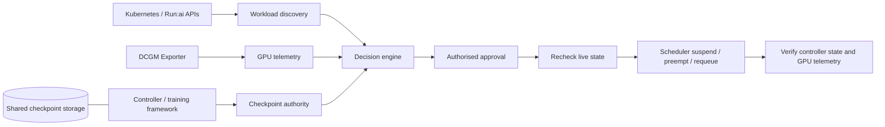

<!-- coderabbit-ai-generated:v1 -->

# Architecture

## MVP: submitted events and simulated approvals

The API receives workload events from callers. Each event supplies workload identity, pod status, GPU utilisation, memory usage, cost inputs, and checkpoint state. The decision engine classifies the event and records its recommendation and audit trail in the database. The submitted checkpoint field is not independently checked against a workload controller or training framework.

An authorised approval of an eligible, recent decision invokes `simulate_operation()` and records `SIMULATED` with a simulation ID. The response has no verification result. The simulation does not contact a cluster, change a workload, release GPU memory, or measure the outcome. An in-progress or failed checkpoint in the submitted event produces `DO_NOT_TOUCH`; this protects against the reported state only.

## Intended production integrations

The following describes a target architecture. These integrations are not implemented in this repository.

- **Platform and discovery:** Kubernetes GPU nodes, with an orchestrator such as NVIDIA Run:ai. Kubernetes and Run:ai APIs are intended to supply pod, job, owner, namespace, priority, and workload-state metadata.
- **Telemetry:** NVIDIA DCGM Exporter is intended to provide GPU utilisation, memory usage, and health metrics. Telemetry must be associated with the correct workload and assessed for freshness.
- **Checkpoint authority:** the workload controller or training framework must supply checkpoint metadata, preferably backed by shared persistent storage. Production decisions must not rely on a checkpoint field submitted by an API caller.
- **Reclamation:** after approval and a fresh safety check, request a safe suspend, preempt, or requeue operation through the scheduler. Never directly force-delete a training pod. The operation must be supported by the deployed scheduler and workload.
- **Verification:** query both DCGM telemetry and the workload controller after the action to confirm the intended workload transition and GPU memory release. Report an unverified or failed outcome when evidence is missing or inconclusive.

Before enabling real operations, the integration needs authenticated access and workload-scoped authorisation, reliable workload identity, fresh and authoritative checkpoint and activity state, and protection against state changes between the final check and the scheduler action. Fail closed when safety cannot be established. Persist operation and audit state durably, and make retries safe when an action succeeds but its response or database update fails.
